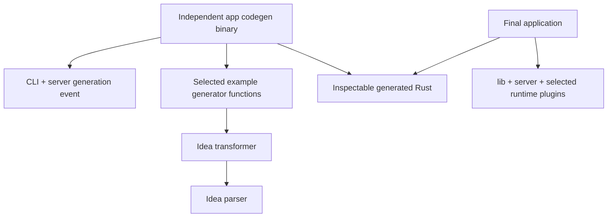

# Slice 3 generation and dependency contract

Proposed Q09 answer for [task 00006](tasks/00006-slice-3-idea.md). Load for clean-build bootstrap, transform selection/order, output ownership, dependencies, first proof and honest failure boundaries; the owner decisions remain in [the checkpoint ledger](slice-3-design-decisions.md).

## Pre-build generation is the initial route

Recommend an application-owned **independent codegen package**, using the existing CLI and capability host, that emits source before the final application is compiled. Do not put first generation behind the existing application binary: that binary can depend on missing generated modules and fail before its `generate` handler runs.

There is no edge from the codegen binary/generator back to the final app or generated contracts, and no normal edge from the final app/contracts to parser/transformer/codegen. Generator and runtime packages may share a small source contract/selection descriptor independent of generated data; they must not share the final application crate as a dependency.

Proposed proof locations: `examples/generated-profile/codegen/` and `examples/generated-profile/app/`, each a real workspace package. The generator plugin is an app-owned module inside codegen. Generated source lives under `app/src/generated/`. A small handwritten `examples/generated-profile/selection.rs` is compiled by both packages; avoid creating another crate solely for two constants.

The actual command is `cargo run -p stackpress-example-profile-codegen -- emit generate`; the tool registers the generation event through the existing Slice 2 CLI/server contracts. Blocking filesystem/formatting work belongs on the tool's bounded blocking worker, not directly across a shared async dispatch executor. It awaits completion, preserves structured failures and starts no listener. Dropping a waiting async future does not magically cancel an already running blocking worker: the tool must await worker ownership through shutdown or report an in-progress/failed generation, with the writer lock held until its real completion.

## Why not `build.rs` now

The KB prefers inspectable source. Cargo's [build-script contract](https://doc.rust-lang.org/cargo/reference/build-scripts.html) directs script output to OUT_DIR, which can persist across builds; it does not supply owned-output cleanup automatically. A build script must not write app source/manifests in place. Declared Cargo dependencies must exist before the build; generation cannot fix a cyclic or undeclared dependency graph mid-build.

Keep a later optional OUT_DIR adapter possible over the same pure planner, but do not implement two orchestration modes for the first proof. That adapter would need `rerun-if-changed` for every transitive source/config/template/selection input and `rerun-if-env-changed` for referenced env names, explicit target-versus-host policy, owned OUT_DIR cleanup, and its own clean/repeat proof. It cannot be claimed complete from the CLI proof.

## Compile-time selection, order and consistency

1. The tool compiles selected generator modules/dependencies behind explicit Cargo features, then calls their ordinary registration functions in listed order. A runtime config string never loads uncompiled code.
2. Registry IDs are unique. Required generators must be selected earlier; wrong dependency order fails rather than silently sorting. Optional-present requirements also validate. Execution is sequential and uses insertion order.
3. Root Idea plugin blocks configure compiled IDs. Unknown/unselected IDs error. When root blocks are present, their order must match the selected registry order (after filtering to configured IDs), or generation errors before effects. They cannot silently reorder it. No blocks means the tool's explicit registry selection supplies defaults. Imported plugin blocks remain inert, rather than secretly selecting code.
4. For the proof, common `selection.rs` declares the profiles selection flag and generator/runtime contract revision. Both tool and app compile it under their corresponding feature selections. Generation emits the selected flag/revision into the registry; app compilation uses const assertions to reject a mismatched generated selection/revision. The same selection source chooses generator registration in the tool and runtime registration in the app. M0 must prove mismatched builds fail; a comment saying “use the same flags” is insufficient.
5. Cargo features are [additive and unified along dependency edges](https://doc.rust-lang.org/cargo/reference/features.html); disabling a default does not subtract another path's feature. Receipts inspect the effective dependency graph. The sample's small flag/revision check is not a claimed universal plugin ABI/version handshake.
6. CI runs the same tool with `emit generate --check` before app build. It composes/replans and byte-compares outputs/manifest without writing, catching changed inputs, stale files or unexpected edits. Plain `cargo build` verifies generated selection and compilation, **not schema freshness**; do not claim automatic freshness without running this check.

No generic plugin-selection file format or Cargo manifest rewriting is needed now. Once framework generator/runtime families exist, their typed runtime-requirement IDs/versions can extend this contract; unresolved package-version distribution belongs to later Q13 work.

## Declared inputs and deterministic planning

Inputs are the root Idea/JSON source, transitively resolved imports, explicit plugin config, selection/contract descriptor, generator source/version, formatter/toolchain choice and referenced environment keys. Plugins needing auxiliary files read through the bounded context input accessor, which records logical name/identity before use. The framework cannot sandbox arbitrary compiled trusted Rust plugin code; direct IO it performs lies outside managed-output promises and must be reviewed as a plugin defect.

Snapshot source bytes and allowed env values once per run, before transforms consume them. Reject a source changed during snapshot acquisition where detectable; this is a reproducibility check in a cooperative workspace, not a transaction with arbitrary outside writers. Environment values stay in memory; manifests/receipts contain names only. Generators must choose deliberately whether any env-derived data is safe to emit. Do not dump the entire compiled schema into generated public contracts by default.

Stable declaration/member/contribution ordering, newline policy (LF, one final newline), deterministic Rust literal escaping, fixed generated headers and the declared formatter version produce stable output. No timestamps, random IDs, absolute machine paths or current directory strings enter files. Use Rust 1.96 rustfmt as an explicit formatting step over staged Rust files; failure prevents installation. Pinning the toolchain for the comparison is part of the stability claim, not a cross-rustfmt-version byte guarantee.

## Output ownership and safe cleanup

Only a dedicated, marked generated root is managed. The initial root must be absent/empty; existing unmarked/nonempty directories error. Every output path is validated relative, excludes parent/root/prefix traversal and control characters, remains beneath the expected root, and has no symlink component. Reject duplicate paths, partition overlap, normalized-name/case collisions and collisions with reserved framework aggregate files before writing. The app's handwritten source and Cargo manifests are outside this root.

Each transform declares owned partitions. It writes fresh files into an in-memory `OutputPlan`; another transform cannot patch/replace them. A coordinator-owned aggregate writer owns `mod.rs` and manifest, consuming ordered declarations from plugins. This replaces ts-morph shared-file mutation without losing cooperation. Future extension of an already generated file requires an explicit contribution API owned by that file's generator, not last-writer-wins edits.

Planning, callback errors and formatting happen before installation. Stage a complete new root beside the destination, on the same filesystem, using secure create-new temporary directories. Preserve the prior owned tree until installation succeeds. The manifest records each relative path, owner, byte length and SHA-256 of its last installed bytes; compare that digest before replacing/removing an owned file. Stale cleanup is computed from the prior ownership manifest and new plan: deleted/renamed model outputs and removed-plugin outputs disappear, with aggregate registries rebuilt from the new plan. Unknown/manual files or manually edited owned files cause a conflict; do not silently delete them or call a raw recursive purge on a user-selected path. The digest detects cooperative-workspace drift, not malicious manifest tampering or outside-write races.

Use a create-new cooperative writer lock outside the replaced tree, held for preflight/install/recovery. A second managed writer fails quickly; no waiting forever or PID-based automatic stale-lock deletion. Document explicit recovery for stale lock/journal state. The root's contract requires exclusive/cooperative ownership: an uncooperative outside editor can race checks. A check-then-write hash comparison is **not** a lock or a guarantee against such a writer.

Directory replacement/backup/rename behavior varies by host. M0 must choose and prove a recoverable install state machine: stage complete → record install intent → retain/move prior root to backup → install staged root → finalize manifest/clear recovery state. There may be a visibility gap between renames. Do not promise crash-atomic multi-file replacement or durability across power loss. On install failure, preserve recoverable backup/journal, report the exact phase, and refuse a new generation until recovery is completed. Normal transform failure leaves the prior output byte-identical.

The conservative conflict policy means a manually edited generated file is not automatically overwritten. Running `--check` reports drift; users restore/remove the disposable generated root explicitly before retrying if they intend to discard edits. There is no implicit force-delete authorization in the CLI operator `-f` metadata.

## Smallest coherent first proof

Use `model Profile { id String name String }` (complete example in [API sketch](slice-3-design-api.md)), the public shape already used by Slice 2. An **example-specific** `profile-demo` transform reads typed Idea model/column data and emits:

- `contracts/profile.rs`: readable public type/fields and serde derives, plus appropriate generated comments/Rustdoc.
- `server/profile.rs`: named in-memory search handler, startup/config/service/operation registration, and the buffered route glue needed for CLI/direct/HTTP comparison.
- `mod.rs` plus owned manifest: explicit public modules and one `register` entry, selection/contract check, no duplicate listeners.

The example generator owns the mapping, fixed public demo rows, id-prefix search, bounded result limit and input-error behavior, based on the existing proof. It accepts only the advertised shape and reports unsupported types/fields/metadata that would change its behavior; it does not guess SQL/admin/assertion semantics. Syntactically valid unknown metadata remains valid Idea, even when a particular generator rejects unsupported behavior.

No `framework-schema` crate is needed for two String fields and an explicitly supplied demo operation. A minimal public semantic layer now would prematurely freeze naming, dictionaries, validation, defaults, relations and storage types. Later framework-schema can implement its full contract and own replacement of the demo generator; the parser/transformer remain unchanged in responsibility.

Proofs: clean output can be absent while the codegen tool still builds; one command generates source; app compiles and returns the same public rows/total through CLI/direct/buffered HTTP; repeat output bytes are equal; remove Profile and rerun to remove its files and registration; empty remaining registry compiles and the operation is 404. Rename/removal tests use a generator fixture that supports the renamed identity or explicitly verify unsupported rename error before effects; do not silently claim arbitrary model-name support from a Profile-only demo.

Also compile `contracts/profile.rs` in a disposable serde-only consumer, with no server/parser/transformer dependency. This proves the contracts partition's normal dependency boundary; it is not an unrun WASM/Leptos/Tauri support claim. Generated executable lines participate in the app's coverage scope.

## Dependency budget

Versions below are major compatibility budgets, not permission to update unrelated lock entries. Every added edge/feature returns in the implementation receipt; additions beyond this table return for coordinator review.

| Consumer | Dependency/features | Justification |
| --- | --- | --- |
| parser | `serde 1`, `default-features=false`, `derive,std` | Typed AST/config JSON contract and validated import/export. Derives don't require server/lib. |
| parser | `serde_json 1`, defaults plus `preserve_order` | Existing compiled JSON fixtures, exact numbers and ordered object data; keep deserializer recursion protection enabled. |
| parser | `indexmap 2`, `serde` | Direct ordered maps for declarations/members/plugin config. Avoid importing all stackpress-lib merely for its alias. Reuse compatible locked version. |
| transformer | parser path dependency; same serde/serde_json where actually used | Composition, manifests, config validation; no duplicate JSON data model or dynamic imports. |
| transformer host writer | `tempfile 3` | Same-parent create-new staging/backup handling; avoids invented predictable temp names. Std filesystem/process APIs provide remaining native IO/formatter work. |
| transformer host writer | `sha2 0.10`, `default-features=false`, `std` | Manifest content digests detect edited prior owned files before replacement/removal. This is drift detection, not a concurrency lock or authenticity guarantee. |
| wrapper | parser and transformer path dependencies | Convenience only; no CLI/server/runtime dependency. |
| app codegen tool | wrapper/transformer, server without HTTP/TTY, CLI without TTY, serde as used, tokio `macros,rt` | Reuse real event/CLI lifecycle; bounded blocking work via runtime adapter. No generated-app dependency. |
| generated proof app | lib/server (buffered `http` for proof), CLI without TTY, serde `derive`, serde_json, tokio `macros,rt` | Same already justified runtime footprint as Slice 2; no generator dependency. |
| test infrastructure | tempfile (reused), tokio test runtime where needed, existing cargo-llvm-cov | Real native IO/error/CLI tests and coverage. No new fuzz engine/test framework required for the first corpus. |
| facade | optional parser/transformer/wrapper path dependencies, explicit opt-in features | Preserve default runtime/browser graph. |

No async runtime in parser/transformer, no `napi`, Node, ts-morph, templating/eval engine, database, Leptos or Tauri dependency is justified by Slice 3. Formatting is an explicit Rust toolchain executable dependency. A filesystem watcher, global cache, dynamic plugin loader and parallel transform executor are unnecessary for the proposed byte-comparing check and sequential proof.
